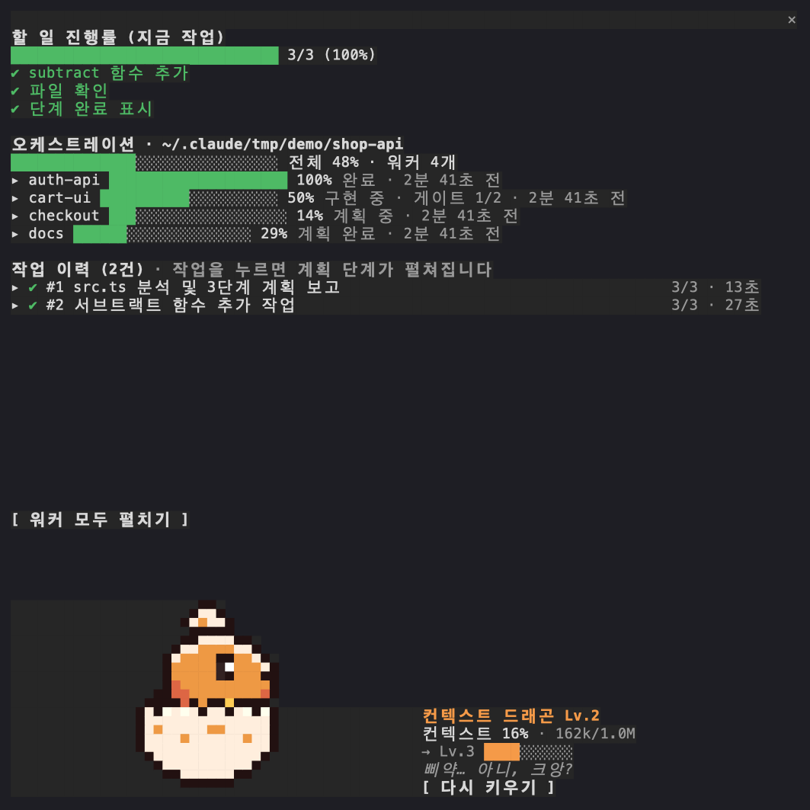
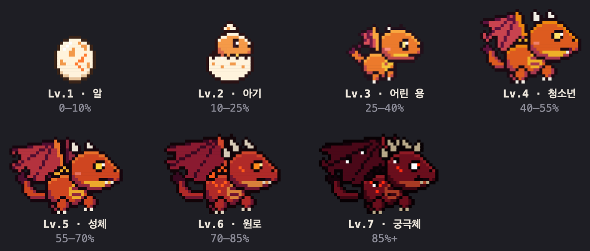

# session-progress

[English](README.md) | **한국어**

**트랜스크립트를 거슬러 올라가지 않아도 Claude Code 세션이 지금 무엇을 하는지 보입니다.**
지금 요청의 계획 진행 바, 단계와 서브에이전트까지 담은 작업 이력, dev-loop
오케스트레이션 실행의 실시간 진행률, 그리고 컨텍스트 창과 함께 자라는 픽셀 용을
pane 하나에 보여 줍니다. 용이 커지는 걸 보고 컨텍스트가 차기 전에 알아챌 수 있습니다.

함수 훅으로 된 플러그인, 즉 *mod* 이며 터미널에 자기 pane 을 그립니다. 읽기만 하고
프로젝트에는 아무것도 쓰지 않습니다.

## 설치

```text
/plugin marketplace add choiyounggi/groundwork
/plugin install session-progress@groundwork
```

넓은 터미널에서는 pane 이 저절로 열리고(`openPaneOnStart` 참고), `/progress` 로
언제든 열 수 있습니다.

**mod 를 지원하는 Claude Code 빌드가 필요합니다.** 2.1.296 에서 확인했습니다. mod
API 는 릴리스마다 바뀌므로 그보다 오래된 빌드에서는 로드되지 않을 수 있습니다.

## 보여 주는 것



실제 세션의 터미널 화면을 그대로 캡처했습니다. 지금 요청의 계획은 끝났고(3/3),
체크아웃에는 워커 4개짜리 dev-loop 실행이 있습니다(이 데모를 위해 dev-loop 자신의
스크립트로 만든 상태입니다). 작업 이력에는 두 작업이 올라 있고, 컨텍스트가 16% 라
용은 막 알을 깨고 나왔습니다.

- **계획 진행 바**는 세션에 `TodoWrite` / `TaskCreate` 가 있으면 그것을 따라갑니다.
  둘 다 없으면 작은 `steps` 도구를 등록하고, 요청마다 2~7개 단계를 보고하도록
  모델에게 안내합니다(`reportSteps` 참고).
- **작업 이력**은 이 세션의 작업을 최대 200개까지 보관합니다. 단계, 걸린 시간,
  그 작업이 띄운 서브에이전트가 담기고, 작업을 누르면 펼쳐집니다. 긴
  프롬프트는 Haiku 를 한 번 불러 짧은 제목으로 줄입니다(`summarizeTitles` 참고).
- **dev-loop 실행**은 [dev-loop](https://github.com/choiyounggi/dev-loop)
  오케스트레이션의 코디네이터 체크아웃에서만 나타납니다. `.orchestration/graph.json`,
  태스크마다의 `.orchestration/status/<task>.json` 과 워커 워크트리 안의 자기 사본
  (`collect-status.sh` 와 같은 규칙으로 합칩니다 — 그래서 코디네이터가 모으기 전에도
  워커의 진행이 보입니다), 그리고 각 워커의 `.dev-loop/gates/` 게이트 원장을 읽습니다.
  워커가 구현하는 동안에는 통과한 게이트만큼 진행률이 올라갑니다. 워커 세션이나 실행이
  없는 레포에서는 아무것도 보이지 않고, dev-loop 를 쓰지 않으면 이 영역은 나타나지
  않습니다.
- **컨텍스트 드래곤**은 세션의 컨텍스트 사용량을 읽어 7단계를 거칩니다. 10% 미만은
  알, 85% 이상은 마지막 형태입니다. 눈을 깜빡이고, Lv.4 부터 불을 뿜고, Lv.6 부터
  불씨를 흩뿌리며, 단계가 바뀔 때는 섬광과 함께 변신합니다. **다시 키우기**는 대화를
  압축하고, 용은 요약이 남긴 크기로 되돌아갑니다. 작업 중에 누르면 그 작업이 끝난
  뒤에 압축합니다.



## 어떻게 만들었나

session-progress 는 **mod** 입니다. 셸 명령이 아니라 엔진이 프로세스 안에서 직접
부르는 TypeScript 함수 훅으로 된 플러그인이고(`hooks/hooks.json` 이 `register.tsx` 를
가리킵니다), pane 의 각 부분이 그 훅 하나하나입니다.

| 기능 | 거는 훅·부르는 API |
|---|---|
| pane 과 프롬프트 위 배너 | `Pane`·`AbovePrompt` 의 `ui.render`, 여는 건 `$.ui.open`. 자체 스크롤 목록에는 `ui.open`·`ui.close`·`ui.scroll` |
| 드래곤 | `Raster` 하나(반블록으로 한 칸에 두 픽셀). pane 이 열려 있는 동안 140ms 타이머로 `$.ui.blit` 해 다시 그림 |
| 계획 진행 바 | `TodoWrite`·`TaskCreate`·`TaskUpdate` 의 `tool.call`, 없으면 `$.tool.register` 로 만든 자체 `steps` 도구 |
| 단계 보고 안내 | `prompt.compose` 에 섹션 추가, 대비책으로 `prompt.submit` context |
| 작업 이력 | `turn.start`·`turn.complete`, 서브에이전트는 `$.agent.list`, 짧은 제목은 `$.model.complete`(Haiku) |
| dev-loop 실행 | `.orchestration/`, `.worktrees/` 아래 워커 사본, 그 워커들의 `.dev-loop/gates/` 를 `$.fs` 로 읽기 |
| 컨텍스트와 다시 키우기 | 사용량은 `session.measure`, 버튼은 `$.session.compact` |
| 상태 | `$.state` 아톰. 그래서 핫 리로드해도 이력이 남음 |

## 설정

`/config` 의 `session-progress` 아래에 있고, `settings.json` 의 `pluginConfigs` 에
저장됩니다.

| 옵션 | 기본값 | 하는 일 |
|---|---|---|
| `language` | `auto` | `auto` 는 Claude Code 의 `language` 설정을, 없으면 로케일(`LC_ALL`, 없으면 `LANG`)을 따릅니다. `en`·`ko` 로 고정할 수 있습니다. |
| `openPaneOnStart` | `true` | 대화형 세션이 시작될 때 pane 을 엽니다. 끄면 `/progress` 로만 열립니다. |
| `reportSteps` | `true` | `TodoWrite` / `TaskCreate` 가 없는 세션에서 `steps` 도구를 등록하고, 한 문단짜리 안내를 시스템 프롬프트에 넣습니다. |
| `summarizeTitles` | `true` | 긴 프롬프트를 Haiku 호출로 작업 이력 제목으로 줄입니다(출력 60토큰, 한 번에 하나씩). |
| `showDragon` | `true` | 컨텍스트 드래곤을 그립니다. 끄면 컨텍스트 한 줄만 보이고 용 애니메이션이 돌지 않습니다. |

단계 보고 안내는 시스템 프롬프트에 들어갑니다. 환경에 따라 플러그인이 시스템
프롬프트에 닿지 못하면, 대신 프롬프트마다 context 로 붙습니다. 모델만 읽고
사람에게는 보이지 않습니다.

## 비용

pane 이 닫혀 있을 때는 느린 주기만 돕니다. 서브에이전트 2초, dev-loop 실행 5초,
제목 대기열 1.5초(`summarizeTitles` 가 켜져 있을 때)입니다. pane 이 열려 있으면 용이
140ms 마다 틱하지만 프레임이 바뀔 때만 다시 그리고, 작업 이력 스피너는 작업이 도는
동안에만 돕니다. 14코어 Mac 에서 pane 을 연 채 쉬고 있는 세션을 재 보니, 이
플러그인이 없는 세션보다 CPU 코어 하나의 약 2.5% 를 더 썼고 대부분은 용의
틱이었습니다. `showDragon: false` 로 그 틱을 끌 수 있습니다.

## 개발

```bash
claude plugin validate plugins/session-progress
claude plugin test plugins/session-progress
# dev-loop 픽스처는 dev-loop 자신의 스크립트로 만듭니다:
bash plugins/session-progress/scripts/dev-loop-fixture.sh <dev-loop 체크아웃> <작업 폴더> \
  > plugins/session-progress/tests/fixtures/dev-loop-run.ts
```

CI 는 `.claude-plugin/marketplace.json` 이 고정한 dev-loop 버전으로 이 픽스처를 다시
만들고, 달라지면 실패합니다. 그래서 상태 형식을 바꾸는 dev-loop 릴리스는 핀이 옮겨진
뒤 다음 실행에서 이 작업을 빨갛게 만듭니다.
