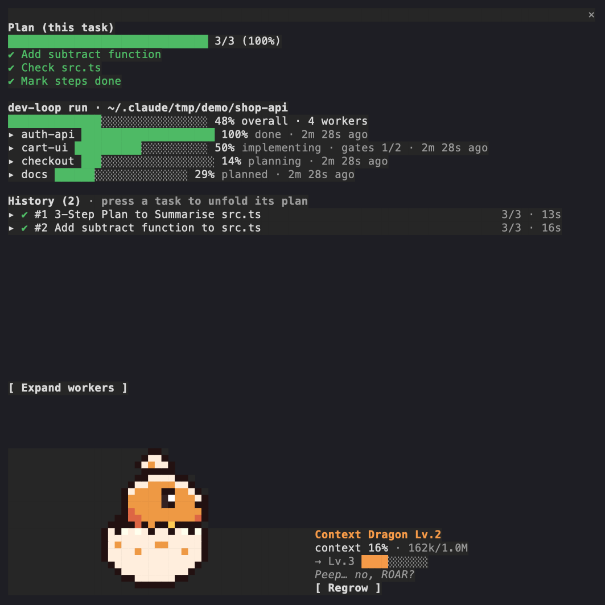
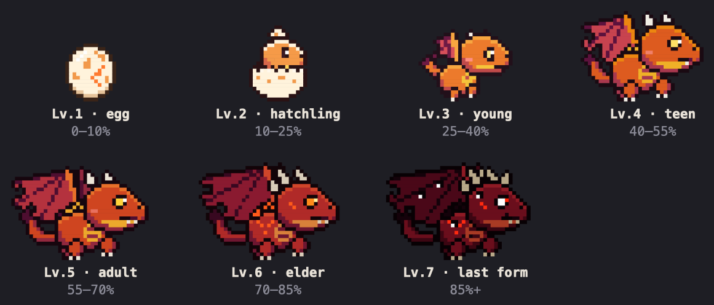

# session-progress

**English** | [한국어](README.ko.md)

**See what your Claude Code session is doing, without scrolling the transcript.**
A plan bar for the current request, a history of every task with its steps and
subagents, the live progress of a dev-loop orchestration run, and a pixel dragon
that grows with your context window, so you notice before it fills up.

It is a *mod*: a plugin of function hooks that draws its own pane in the
terminal. It reads; it never writes to your project.

## Install

```text
/plugin marketplace add choiyounggi/groundwork
/plugin install session-progress@groundwork
```

The pane opens on its own in a wide terminal (see `openPaneOnStart`);
`/progress` opens it any time.

**Requires a Claude Code build with mod support.** Verified on 2.1.296; the mod
API moves between releases, so an older build may not load it.

## What it shows



A live session, captured from the terminal: the request's plan is done (3/3),
the checkout holds a dev-loop run with four workers (written by dev-loop's own
scripts for this demo), the history lists both tasks, and the context is at 16%,
so the dragon has just hatched.

- **Plan bar** follows `TodoWrite` / `TaskCreate` when your session has them.
  When it has neither, the plugin registers a small `steps` tool and asks the
  model to report 2-7 steps per request (see `reportSteps`).
- **History** keeps up to 200 tasks of this session: steps, duration, and the
  subagents each task started. Press a task to unfold it.
  Long prompts get a short title from a one-off Haiku call (see
  `summarizeTitles`).
- **dev-loop run** appears only in the coordinator's checkout of a
  [dev-loop](https://github.com/choiyounggi/dev-loop) orchestration. It reads
  `.orchestration/graph.json`, each task's `.orchestration/status/<task>.json`
  together with the worker's own copy in its worktree (merged the way
  `collect-status.sh` merges them, so a worker shows its progress before the
  coordinator collects it), and the gate ledgers in each worker's
  `.dev-loop/gates/`. While a worker builds (under `plan_ready`, as dev-loop
  writes it), the gates it has passed move its percent; it counts the ledgers
  written so far, so it is approximate. Worker sessions and repos without a run
  show nothing here. Without dev-loop the section never appears.
- **Context Dragon** reads the session's context usage and moves through seven
  stages, from egg (under 10%) to the last form (85% and up). It blinks, breathes
  fire from Lv.4, sheds embers from Lv.6, and changes with a flash between
  stages. **Regrow** runs a compaction and the dragon shrinks back to what the
  summary left; pressed during a task, it waits for the task to end.



## How it is built

session-progress is a **mod**: a plugin whose hooks are TypeScript functions the
engine calls in-process (`hooks/hooks.json` names `register.tsx`), not shell
commands. Every part of the pane is one of those hooks:

| Feature | What it hooks or calls |
|---|---|
| The pane and the band above the prompt | `ui.render` on `Pane` and `AbovePrompt`, opened with `$.ui.open`; `ui.open`, `ui.close` and `ui.scroll` for its own scrolling list |
| The dragon | one `Raster` (two pixels per cell as half blocks), repainted by `$.ui.blit` on a 140 ms timer while the pane is open |
| Plan bar | `tool.call` on `TodoWrite` / `TaskCreate` / `TaskUpdate`, or a `steps` tool of its own from `$.tool.register` |
| Step guide | a section added in `prompt.compose`, with `prompt.submit` context as the fallback |
| Task history | `turn.start` / `turn.complete`, subagents from `$.agent.list`, short titles from `$.model.complete` (Haiku) |
| dev-loop run | `$.fs` reads of `.orchestration/`, the workers' copies under `.worktrees/`, and their `.dev-loop/gates/` |
| Context and Regrow | `session.measure` for usage, `$.session.compact` for the button |
| State | `$.state` atoms, so a hot reload keeps the history |

## Configure

`/config` lists these under `session-progress`; they are stored in
`settings.json` under `pluginConfigs`.

| Option | Default | What it does |
|---|---|---|
| `language` | `auto` | `auto` follows Claude Code's `language` setting, then the locale (`LC_ALL`, else `LANG`); `en` or `ko` pins it. |
| `openPaneOnStart` | `true` | Open the pane when an interactive session starts. Off: only `/progress` opens it. |
| `reportSteps` | `true` | In sessions without `TodoWrite` / `TaskCreate`, register the `steps` tool and add its one-paragraph guide to the system prompt. |
| `summarizeTitles` | `true` | Shorten long prompts into history titles with a Haiku call (60 tokens out, at most one at a time). |
| `showDragon` | `true` | Draw the Context Dragon. Off: the pane shows a one-line context gauge and the dragon's animation never runs. |

The step guide is added to the system prompt. If something in your setup keeps
plugins out of the system prompt, the guide rides on each prompt's context
instead; the model reads it, you never see it.

## Cost

With the pane closed, only slow polls run: subagents every 2 s, a dev-loop run
every 5 s, and a title queue every 1.5 s (when `summarizeTitles` is on). With the
pane open, the dragon ticks every 140 ms but repaints only when its frame
changes, and the history spinner runs only while a task does. Measured on a
14-core Mac with the pane open and the session idle, the plugin adds about 2.5%
of one core over a session without it, most of it the dragon's tick;
`showDragon: false` turns that tick off.

## Develop

```bash
claude plugin validate plugins/session-progress
claude plugin test plugins/session-progress
# the dev-loop fixture is generated from dev-loop's own scripts:
bash plugins/session-progress/scripts/dev-loop-fixture.sh <dev-loop checkout> <scratch dir> \
  > plugins/session-progress/tests/fixtures/dev-loop-run.ts
```

CI regenerates that fixture against the dev-loop version pinned in
`.claude-plugin/marketplace.json` and fails when it differs, so a dev-loop
release that changes the status format turns this job red on the next run after
the pin moves.
